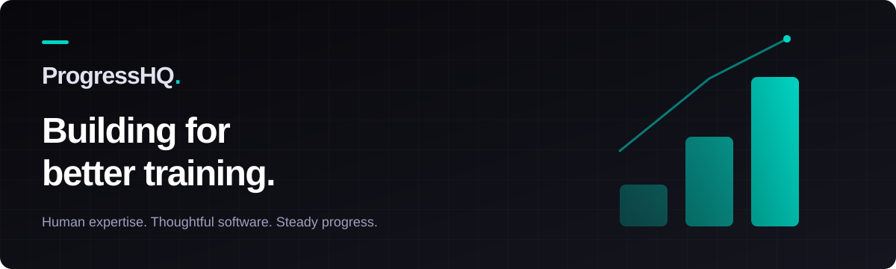

  

  Software for the people behind the progress.
   
  <a href="https://trainely.app"><strong>Explore Trainely ↗</strong></a>
  &nbsp; · &nbsp;
  <a href="https://github.com/ProgressHQ?tab=repositories">Browse our public projects</a>

## Better tools. Stronger coaching.

We're building **[Trainely](https://trainely.app)**, a platform for personal trainers and athletes. Our focus is the work they do together: planning training, recording sessions, and turning feedback into progress.

We believe good software should give coaches more room to coach and athletes more clarity in their training.

## From our workshop

Alongside Trainely, we're building tools for exercise content and payments.

| Project | What it's for |
| :--- | :--- |
| **[FitVault](https://github.com/ProgressHQ/fitvault)** | An exercise video library project for coaches and athletes. |
| **[OpenPay SDK](https://github.com/ProgressHQ/openpay-sdk)** | An open-source, provider-neutral payment abstraction for SaaS applications and internet services. |

## Build with us

Explore the public repositories to see what we're working on. For questions, bug reports, or ideas about a project, start with its README and issue tracker.

---

<strong>ProgressHQ</strong> · The team building <a href="https://trainely.app">Trainely</a>

